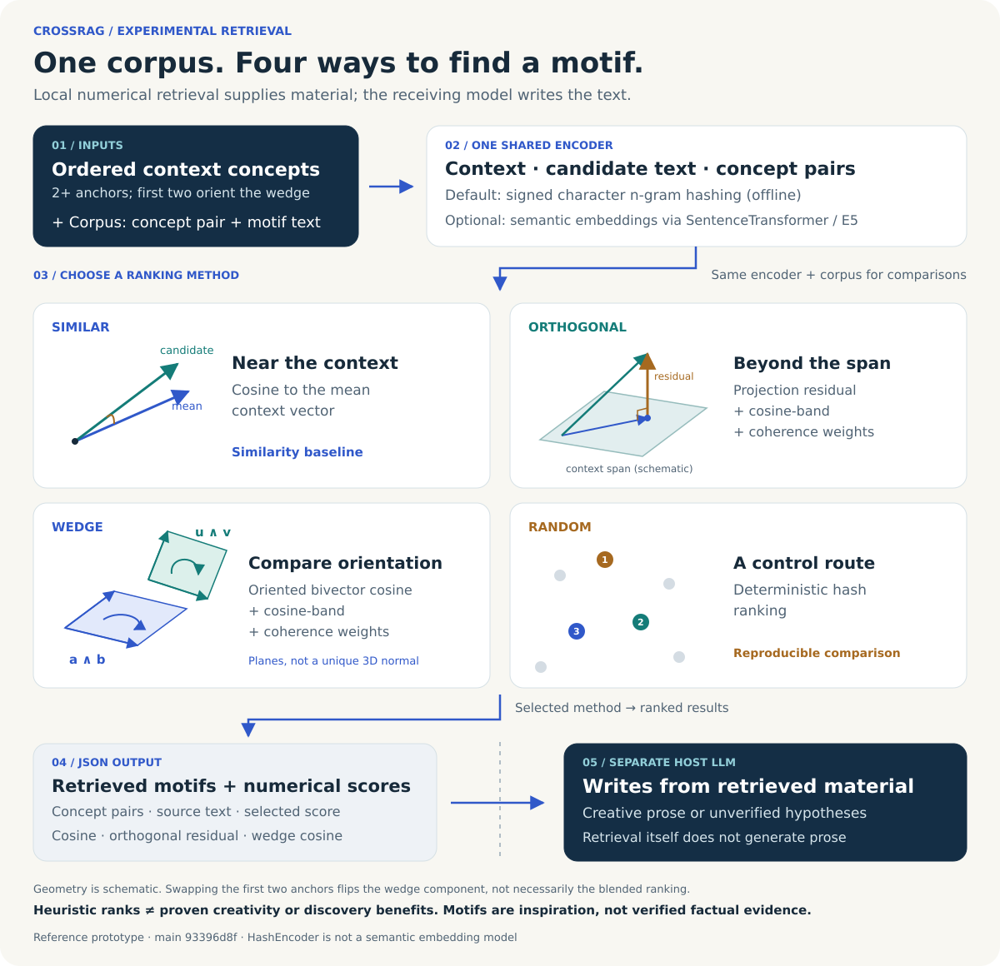
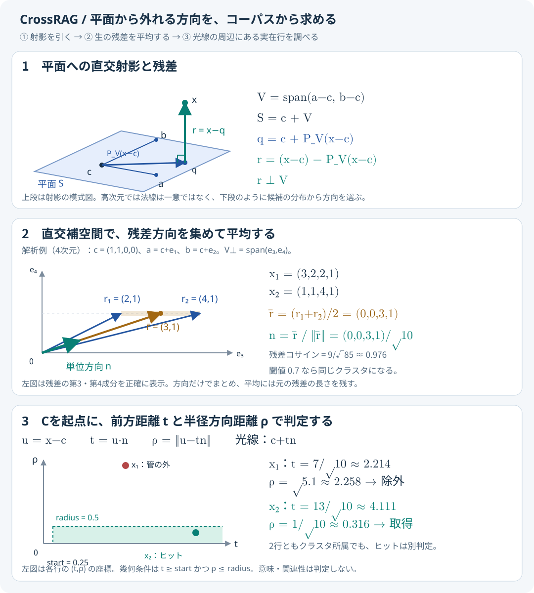

# CrossRAG

CrossRAGは、会話データ、明示コーパス、または別工程で生成したLLM知識poolを扱い、幾何検索と一様抽選を区別して結果をUTF-8のJSONで返すスキルです。

- **入力素材は明示必須**: 幾何検索は会話データまたは明示コーパスを使います。`--demo-corpus`は明示opt-inで、出力に`corpus_source: "demo"`を記録します。LLM知識poolは会話から分離して生成したJSONを`--llm-pool`で読み込みます。
- **単一指標のみによる順位付け**: `engine.py` / `run.py`では各モードが単一指標（`similar=cosine`、`orthogonal=orthogonal_residual`、`wedge=gram_bivector_cos`）のみで順位を決定します。複合スコア（`score`）や`band`・`novelty`・`coherence`の重み付けは使用しません。
- **生の計算結果のみを出力**: デフォルトでは解釈・心理的読み・比喩的説明・創作を一切加えず、入力コンテキスト・`corpus_source`・使用エンコーダ（`HashEncoder`の場合は意味埋め込みではなく文字n-gramハッシュであること）・単一指標と生の計算値のみを報告します。

この方式は意味・関連性・新規性を判定せず、文章や概念を生成・捏造しません。無関係な文や意味のない文も幾何条件を満たせばヒットします。空の結果も正しい結果で、既定値でヒットする保証はありません。有用性、創作品質、通常のRAGに対する優位性は実証されていません。

## アーキテクチャ



A・B・Cと全コーパス行を同じ`encoder.encode_passage`経路で埋め込みます。Cを通るアフィン平面からの残差をクラスタ化し、条件を満たすクラスタの平均残差方向に光線を作ります。検索するのは、その光線に対する前方距離と半径の条件を満たす既存行だけです。高次元の平面に一意の法線を仮定せず、方向はコーパスの分布から推定します。

既定のエンコーダは、オフラインの文字 n-gram ハッシュ特徴（`hash-ngram（文字特徴・意味理解ではない）`）です。意味埋め込みではありません。SentenceTransformerによる意味埋め込みも選べますが、その場合もnormal-ray検索は意味や関連性で候補を選別しません。ユーザーが明示的に解釈・創作を求めた場合のみ別工程として扱い、生の数値計算結果とは明確に区別します。

単一指標の3つの順位付け方式（`similar` / `orthogonal` / `wedge`）とPCA×外積の光線検索も備えています。CLIごとに引数・出力・既定値が異なります。詳細は以下と[SKILL.md](skill/crossrag/SKILL.md)を参照してください。

## 数学的な見方



平面への射影点を`q = c + P_V(x-c)`とすると、残差`r = x-q`は平面の方向空間`V`に直交します。似た方向の残差をまとめ、その**生の平均**を正規化した`n`が、そのクラスタから選ぶ法線方向です。各行が光線に近いかは、残差方向の近さとは別に判定します。

図の中・下段は同じ4次元の解析例です。候補を`x₁`・`x₂`の2行とし、クラスタ閾値`0.7`、最小行数`2`で方向を求めます。半径を`0.5`、開始距離を`0.25`にすると、両方ともクラスタに属しますが、取得されるのは`x₂`だけです。`x₁`は平面内のずれも大きく、光線から遠いためです。これは計算を説明する合成例で、実コーパスの検索結果ではありません。図の半径`0.5`はCLIの既定値`0.25`とは異なります。

## 入っているもの

インストール単位は[`skill/crossrag`](skill/crossrag)です。このディレクトリを、そのままエージェントのスキル置き場へコピーします。

```text
skill/crossrag/
  LICENSE
  SKILL.md
  requirements.txt
  agents/openai.yaml
  scripts/third_concept_cli.py  # normal-ray / third-concept CLI
  scripts/residual_ray.py       # アフィン残差クラスタと光線近傍検索
  scripts/third_concept.py      # 共通エンコーダ、第三概念順位付け、旧PCA光線
  scripts/run.py                # 単一指標3方式（similar/orthogonal/wedge）のCLI
  scripts/engine.py             # 単一指標順位付け本体、ハッシュエンコーダ
  scripts/llm_pool.py           # LLM知識poolの検証と一様抽選
  scripts/compare_third_concept.py
  references/methodology.md
  references/modes.md
  references/example-corpus.json
  tests/                       # 回帰テストと合成fixture
```

## まず一度使う: residual-cluster normal-ray

Python 3.10以上とNumPyが準備済みなら、リポジトリのルートから次を実行します。依存が足りない場合は後述の「準備」を参照してください。

```powershell
Set-Location skill/crossrag
python scripts/third_concept_cli.py --A "概念A" --B "概念B" --C "出典記事" --corpus references/example-corpus.json --encoder hash --search-mode ray --ray-radius 0.25 --ray-start-distance 0.25 --ray-cluster-cosine 0.7 --ray-min-cluster-size 2 --limit 5
```

`--A`・`--B`・`--C`にはテキストを直接渡します。`--C`はファイル名を読み込むオプションではありません。上の例は同梱の4行のJSONファイルを使います。

出力の`status`、`clustering`、`rays`を確認してください。`--limit 5`は**返す光線の最大本数**で、ヒット件数ではありません。クラスタがあっても光線近傍に行がなければ`no_hits`になり、クラスタが成立しなければ`no_residual_clusters`になります。既定値で0件になることは異常ではありません。

以下の検索コマンドも`skill/crossrag`をカレントにして実行します。`--corpus`や`--conversation`の相対パスは**プロセスのカレントディレクトリ**から解決されます。この手順では`references/example-corpus.json`が正しく、`skill/crossrag/references/example-corpus.json`ではありません。別の場所から実行する場合やリポジトリ外のコーパスには、実際のカレントに合うパスか絶対パスを指定します。

## 準備

Python 3.10以上とNumPyが必要です。既定のハッシュエンコーダはオフラインで動きます。これは文字 n-gram の特徴ベクトルであり、意味埋め込みではありません。OS管理下のPython環境では仮想環境を使ってください。

リポジトリのルートから依存を入れる例:

```powershell
python -m pip install -r skill/crossrag/requirements.txt
```

macOS/Linuxでは、リポジトリのルートで、たとえば次のように仮想環境を使えます。

```bash
python3 -m venv .venv
source .venv/bin/activate
python -m pip install -r skill/crossrag/requirements.txt
```

macOS/Linuxで`python`がPython 3.10以上を指さない場合は、`python3`で仮想環境を作成・有効化してから依存を入れてください。管理されたPython環境がpipによる直接インストールを拒否する場合も、仮想環境を使います。既に`skill/crossrag`へ移動している場合、依存ファイルは`requirements.txt`です。

意味埋め込みを使う場合だけ、別途`sentence-transformers`とモデルが必要です。`--encoder semantic`は`SentenceTransformer(model_name)`を使い、未取得のモデルはダウンロードされる場合があります。モデルがローカルにあることを確認してください。既定モデルは`intfloat/multilingual-e5-small`です。`hash`による検索はネットワークや有料APIを使いません。

## normal-rayの入力と既定値

`third_concept_cli.py`自体の`--search-mode`の既定は`third-concept`です。normal-rayには**`--search-mode ray`を指定**します。そのrayモード内の`--ray-method`の既定が`residual-cluster`です。スキル全体の`run.py`の既定方式を変えるものではありません。

| オプション | residual-clusterでの意味・既定値 |
| --- | --- |
| `--A` / `--B` / `--C` | 必須の空でないテキスト。Cは光線の原点となる出典記事 |
| `--corpus` | UTF-8のJSON配列へのパス。`--demo-corpus`を使わない場合は必須。|
| `--demo-corpus` | 同梱demoを明示的に選択。出力の`corpus_source`は`demo`。|
| `--encoder` | `hash`（既定）または`semantic` |
| `--model` | semantic用のモデルID。既定は`intfloat/multilingual-e5-small` |
| `--prefix-policy` | `auto`（既定）/ `e5` / `prefix-free`。hashには影響しない |
| `--ray-method` | `residual-cluster`（既定）/ `pca-cross` |
| `--ray-radius` | 光線からの半径の上限。既定`0.25`、有限の正数 |
| `--ray-start-distance` | 原点Cからの前方距離の下限。既定`0.25`、有限の非負数 |
| `--ray-cluster-cosine` | seedの残差方向とのコサイン閾値。既定`0.7`、範囲`(0,1]` |
| `--ray-min-cluster-size` | 光線を作る最小クラスタ行数。既定`2`、1以上の整数 |
| `--limit` | 最大光線数。既定`5`、1以上の整数。各光線のヒット件数は制限しない |
| `--exclude` | 除外語。複数回指定可。既定は除外なし |

residual-clusterでは`--no-center`、`--vocab`、`--ray-cluster-gap`、`--ray-min-set-size`はエラーです。rayモードでは`--emit-prompt`、`--hypotheses`、`--with-math`や順位付け用の非既定`--method`・`--seed`・`--null-samples`、`--p-min`を併用できません。詳細な引数一覧は`python scripts/third_concept_cli.py --help`で確認できます。

### コーパス形式とエンコード

normal-ray用のJSON配列は、次の行形式を受け付け、混在も可能です。各文字列は空でない必要があります。

- 本文だけの文字列、または`line`だけをキーに持つオブジェクト: `"本文"`、`{"line":"本文"}`
- 3要素配列、または`a`・`b`・`line`を持つオブジェクト: `["概念1","概念2","本文"]`、`{"a":"概念1","b":"概念2","line":"本文"}`

本文だけの行はその本文、ペア行は`aとb。line`に整形したテキストをエンコードします。出力には元の`a`・`b`・`line`を保持し、本文だけの行の`a`・`b`は`null`です。任意の独自IDや追加メタデータを保持するスキーマではありません。

A・B・Cと**渡された全コーパス行**は、明示除外の適用前に同じ`encoder.encode_passage`経路でエンコードされます。この方式で`encode_query`は使いません。ロールprefixを使う設定では、入力テキスト先頭の既知の`query: ` / `passage: `を取り除いてから、全てに同じpassage prefixを付けます。出力の原文はこの処理で書き換えません。prefix-freeとhashではロールprefixを追加しません。

semanticの`--prefix-policy auto`はモデルIDに`e5`を含む場合にE5のprefixを選び、それ以外はprefixなしです。`e5`または`prefix-free`で上書きできます。未知のモデル固有の指示形式までは自動判定しないため、モデル仕様を確認してください。

### 幾何とヒット条件

A・B・Cのエンコード結果を`a`・`b`・`c`とします。エンコーダが返した座標を使い、コーパス平均による中心化や残差の長さの均一化は行いません。

1. 出典平面を`S = c + span(a-c, b-c)`、`V = span(a-c, b-c)`とします。
2. コーパス行のベクトル`x`ごとに、生の残差`r = (x-c) - P_V(x-c)`を求めます。
3. 元のコーパス順に、未割当の最初の有効残差をseedとし、seedとの残差方向コサインが閾値以上の未割当行をまとめます。更新した平均や推移的な近さでは判定しません。同じ順序では決定的ですが、行順を変えるとクラスタも変わりえます。コサイン比較には`1e-12`の許容差があります。
4. 最小行数を満たすクラスタの**生の残差ベクトルの算術平均を正規化**して単位方向`n`を作り、`c + t n`を光線とします。合成残差がゼロと判定されたクラスタからは光線を作りません。
5. 明示除外されていない全行について`u = x-c`、前方距離`axial = u·n`、半径方向距離`radial = ||u - axial n||`を計算します。**`axial >= start_distance`かつ`radial <= radius`**を満たす行を返します。どちらの境界も含みますが、浮動小数点の丸めは境界付近に影響します。

距離は生のエンコーダ座標上の距離です。平面内の成分も`radial`に含まれるため、クラスタのメンバーが自動的にヒットするわけではありません。メンバー以外もヒットでき、同じ行が複数の光線に現れる場合もあります。光線はクラスタ行数の降順、同数ならseedの元インデックス順で最大`--limit`本に絞り、各光線のヒットは`radial_distance`、元インデックスの順に並べます。

残差ノルムが内部閾値`min_residual_norm = 1e-9`以下の行はクラスタ化に使わず、`axial`を厳密に`0.0`とし、`radial = ||x-c||`で検索対象に残します。この閾値はCLIでは変更できません。`--ray-start-distance 0`なら平面内の行も半径条件次第でヒットします。極小の開始距離や大きな座標スケールでは、この閾値と丸めの影響に注意してください。同一テキストが常に同一ベクトルになることをsemantic実モデルで確認したわけではありません。

### 出力JSONの読み方

主なキーは次のとおりです。`run.py`の`selected`や旧PCA方式の集合スキーマとは区別してください。

| キー | 内容 |
| --- | --- |
| `mode` / `method` | `"normal-ray"` / `"affine_residual_cluster"` |
| `status` | `hits_found` / `no_hits` / `no_residual_clusters` / `plane_unavailable` |
| `input` / `encoder` | 元のA・B・C、エンコーダの`name`・`model_id`・`prefix` |
| `corpus_id` / `corpus_size` | ファイル指定時はファイルバイト列、未指定時は内部行データのJSONをUTF-8化したもののSHA-256先頭16桁と、除外前の行数 |
| `params` | `coordinates: "raw_encoder_embedding"`、`encoding_path: "encode_passage"`、`origin: "C"`、平面式と検索・除外パラメータ |
| `plane` | `status`・`origin`・`singular_values`・`dimension`。利用可能なら`basis`、利用不可なら`reason` |
| `clustering` | 候補数・除外数・有効残差数、`unusable_corpus_indices`、クラスタ数、小クラスタ・ゼロ合成残差・最大本数による省略の件数 |
| `rays` | 各光線の`ray_id`、`seed_corpus_index`、`member_corpus_indices`、`member_count`、`direction`、`mean_residual`、`resultant_norm`、`coherence`、`hit_count`、`hits` |
| `rays[].hits[]` | `corpus_index`、`a`、`b`、`line`、`axial_distance`、`radial_distance`、`in_cluster` |
| `warnings` / `disclaimer` | 警告と、幾何検索の限界の説明 |

出典は`corpus_id`と、除外前の元の行順に対応する0始まりの`corpus_index`で追跡します。`in_cluster`は、そのヒットが当該光線を定めたクラスタに属するかを示します。`coherence = ||sum r|| / sum ||r||`は残差方向の揃い方であり、文章の意味的一貫性ではありません。

`no_hits`は光線があってもヒットがない状態です。`no_residual_clusters`は有効残差がない、最小行数を満たさない、全候補が明示除外されたなど、光線が残らない状態です。平面が作れない場合は`plane_unavailable`となり、`reason`は`embedding_dimension_below_three`、`source_anchors_coincide`、`plane_rank_deficient`のいずれかです。不正な入力・非有限値などの検証エラーは、JSONの状態ではなくCLIのエラー（終了コード2）になります。

### 検索の限界と任意の後処理

意味・関連性・類似度による除外はありません。除外するのは、明示した`--exclude`語をNFKC・casefold・空白除去後の部分一致で含む行だけです。A/B/Cに近い行やC自身の行も幾何条件次第で対象になります。除外語はペア行の`a`・`b`・`line`それぞれに照合します。

半径・開始距離・クラスタ閾値はエンコーダ間で較正されておらず、コーパスと行順にも依存します。空の結果から意味的な不在を結論できません。検索結果も事実確認や因果関係の証拠にはなりません。

必要なら検索後にホストLLMへ、原文と出典IDを保持しつつ解釈・仮説・創作を依頼できます。生成内容は検索された原文と分け、未検証の解釈であると明記します。normal-ray CLI自体はLLMを呼ばず、新しい文や仮説を作りません。

## LLM知識poolの抽選

会話や現在の文脈を使わずに概念を抽選する場合は、先にホストLLMの知識からpoolを別ステップで作ります。新しい依頼では毎回poolを生成し直し、概念だけでなく分野も変えます。保存済みpoolの再利用は、以前の抽選を明示的に再現する場合に限ります。新しい隔離済みリクエストを使い、親会話や文脈語を渡さないでください。ホストが分離を保証できない場合は、その境界を明記し、文脈非公開とは主張しないでください。次の固定promptに文脈語を追加しません。

```text
From your general learned knowledge, list 40 distinct concepts across varied fields. Choose a fresh mix of fields and concepts for this request. Return only a JSON array of non-empty strings. Do not use conversation history or user-provided context. Do not claim external retrieval unless you can confirm it was used.
```

結果をUTF-8のJSON配列として保存し、`skill/crossrag`からいずれかのCLIを実行します。

```powershell
python scripts/run.py --llm-pool path/to/pool.json --limit 5 --seed 17
python scripts/third_concept_cli.py --llm-pool path/to/pool.json --limit 5 --seed 17
python scripts/compare_third_concept.py --llm-pool path/to/pool.json --limit 5 --seed 17
```

`--llm-pool-model`は生成モデル名が分かる場合だけ指定します。`--context`は必須ではなく、指定してもpool抽選に使いません。CLIはJSON配列の非空文字列を検証し、外側の空白を除き、Unicode NFKC・case-fold・空白正規化後の重複を除きます。重複除去後10件未満なら終了コード2で失敗します。`--limit`が一意な件数を超える場合も失敗します。

seedを省略すると毎回新しい53-bit seedを生成し、結果に記録します。これはJSONをIEEE-754数値で扱うクライアントでも正確に再入力できます。seedを指定すると、同じpoolとNumPyバージョンで同じ順序を再現します。seedは文脈から作らないでください。結果は`mode: "llm-pool"`、`corpus_source: "llm_knowledge"`、`knowledge_basis: "host_llm_general_knowledge"`、`ranking_metric: "seeded_uniform_draw"`、`encoder: "none"`、`generation_model`、`selected`、`total`を記録します。`selected[].index`は重複除去後の配列に対する0始まりの位置です。`rank_value`は抽選順を示し、類似度や有用性の順位ではありません。文脈との組合せは抽選後に利用者が望む場合だけ別工程で行います。

## その他のCLI: 単一指標の順位付けとPCA光線

### 3つの単一指標順位付け方式（run.py）

`run.py`と[SKILL.md](skill/crossrag/SKILL.md)は、会話データ（`--conversation`）、明示コーパス（`--corpus`）、明示demo（`--demo-corpus`）のいずれかを必須とします。LLM知識poolは`--llm-pool`で別モードとして抽選します。demoは`corpus_source: "demo"`と記録されます。以下は`skill/crossrag`から実行します。

```powershell
python scripts/run.py --context "犬、カレー、夕暮れ" --conversation path/to/conversation.json --mode orthogonal
python scripts/run.py --context "犬、カレー、夕暮れ、帰宅" --corpus references/example-corpus.json --mode wedge --limit 5
python scripts/run.py --context "記憶、法線、検索" --conversation path/to/conversation.txt --mode orthogonal --limit 5
python scripts/run.py --context "犬、カレー" --mode similar --encoder hash --demo-corpus
```

- **similar**（`ranking_metric: "cosine"`）: 文脈アンカーの平均ベクトルと候補文のコサイン類似度のみで順位付け。
- **orthogonal**（`ranking_metric: "orthogonal_residual"`）: 文脈アンカー全体が張る部分空間への射影残差ノルムのみで順位付け。複合スコア・帯域・novelty・coherence重みは一切混ぜません。
- **wedge**（`ranking_metric: "gram_bivector_cos"`）: 向き付き双ベクトル`a∧b`と`u∧v`のコサインのみで順位付け。先頭2概念の順序交換で符号が反転します。高次元の一意の3次元法線や言語的な方向を表しません。

幾何モードでは`--context`に2つ以上の概念を指定し、`--mode`（別名`--method`）から`similar` / `orthogonal` / `wedge`を選びます。`--conversation`・`--corpus`・`--demo-corpus`のいずれか1つが必須です。`--llm-pool`は幾何モードと併用しません。`run.py`と`third_concept_cli.py`はpool modeでも任意の`--context`を受け付けますが、抽選には使いません。`compare_third_concept.py`には`--context`がなく、A/B入力もpool modeでは受け付けません。コーパスには2件以上の候補が必要です。

出力は`context`・`mode`・`ranking_metric`・`corpus_source`（`"conversation"` / `"explicit"` / `"demo"`）・`encoder`・`selected`・`total`・`warnings`・`note`（「順位は指定された単一指標のみで決定。複合スコアは使用しない」）を持つJSONです。`selected`の各行には`index`・`a`・`b`・`line`・`rank_value`・`ranking_metric`・`cosine`・`orthogonal`・`wedge`が入ります（旧`score`キーは廃止）。hashと短い語の組合せでは全候補のwedge成分が0になる場合があるため、`warnings`を確認してください。

同じエンコーダ、コーパスで比較してください。式と限界は[methodology.md](skill/crossrag/references/methodology.md)、出力ポリシーとモードの詳細は[modes.md](skill/crossrag/references/modes.md)にあります。

### 旧PCA×外積の光線（明示選択）

```powershell
python scripts/third_concept_cli.py --A "概念A" --B "概念B" --corpus references/example-corpus.json --encoder hash --search-mode ray --ray-method pca-cross --limit 5
```

`pca-cross`は旧来の中心化PCA・A×Bの向き・前方距離の間隔による集合化・入力に近い候補の除外を保ちます。`--C`、`--ray-cluster-cosine`、`--ray-min-cluster-size`は受け付けません。半径と開始距離は既定`0.25`、`--ray-cluster-gap`は`0.25`、`--ray-min-set-size`は`2`です。この方式の`--limit`は各種類の集合の最大数であり、residual-clusterの光線数とは異なります。JSONには`ray`・`concept_sets`・`passage_sets`があり、状態は`sets_found` / `no_sets` / `ray_unavailable`です。

### 第三概念の候補順位付け

`third_concept_cli.py`で`--search-mode ray`を付けない場合は、`third-concept`または`--method third-concept-ratio`による候補順位付けです。出力は`candidates`と`origin`などを持ち、normal-rayの`rays`ではありません。外部LLMの仮説ファイルや比較スクリプトについては[第三概念の設計](docs/third_concept_design.md)を参照してください。この設計文書のquery/passageや中心化の説明は第三概念順位付けのもので、residual-clusterの共通passage経路・生座標とは区別します。

## 各ホストへの入れ方

配布・実行単位は`skill/crossrag`フォルダー全体です。`SKILL.md`だけを移さず、`scripts/`、`references/`、`requirements.txt`、`LICENSE`との相対位置を保ってください。Codex・Gemini CLI・Grok Build・Piのユーザー共通パスは`~/.agents/skills/crossrag`です。Claude Codeのユーザーパスは`~/.claude/skills/crossrag`で、`.agents/skills`は探索先に含まれません。Codex向けの`agents/openai.yaml`はCodex UI用の任意メタデータです。

リポジトリのルートからPowerShellで配置する例:

```powershell
$shared = Join-Path $HOME ".agents\skills\crossrag"
$claude = Join-Path $HOME ".claude\skills\crossrag"
New-Item -ItemType Directory -Force -Path $shared, $claude | Out-Null
robocopy .\skill\crossrag $shared /E /XD .ruff_cache __pycache__ .pytest_cache
if ($LASTEXITCODE -ge 8) { throw "CrossRAG shared install failed: $LASTEXITCODE" }
robocopy .\skill\crossrag $claude /E /XD .ruff_cache __pycache__ .pytest_cache
if ($LASTEXITCODE -ge 8) { throw "CrossRAG Claude install failed: $LASTEXITCODE" }
```

macOS/Linuxでの例:

```bash
mkdir -p "$HOME/.agents/skills/crossrag" "$HOME/.claude/skills/crossrag"
rsync -a --exclude='.ruff_cache/' --exclude='__pycache__/' --exclude='.pytest_cache/' skill/crossrag/ "$HOME/.agents/skills/crossrag/"
rsync -a --exclude='.ruff_cache/' --exclude='__pycache__/' --exclude='.pytest_cache/' skill/crossrag/ "$HOME/.claude/skills/crossrag/"
```

| ホスト | ユーザー領域の配置先 | 認識確認・明示起動 |
| --- | --- | --- |
| Codex | `~/.agents/skills/crossrag/` | `/skills`で一覧、`$crossrag`で明示起動。表示されなければ再起動 |
| Claude Code | `~/.claude/skills/crossrag/` | `/skills`で一覧、`/crossrag`で明示起動。新しいskill directoryをセッション中に追加したら`/reload-skills` |
| Gemini CLI | `~/.agents/skills/crossrag/`または`~/.gemini/skills/crossrag/` | `gemini skills list`または`/skills list`で確認し、説明に合う依頼を自然文で送る。個別skillのslash起動は公式CLI資料に記載なし。`/skills reload`で再読込 |
| Grok Build | `~/.agents/skills/crossrag/`または`~/.grok/skills/crossrag/` | `/skills`で一覧、`/crossrag`で明示起動。表示されなければ再起動 |
| Pi | `~/.agents/skills/crossrag/`または`~/.pi/agent/skills/crossrag/` | `/skill:crossrag`で明示起動、`/reload`で再読込 |

上記は各ホストの公式探索先とコマンドに基づく案内です。プロジェクト領域の場所や信頼設定はホストごとに異なります。配布・設定の説明は、各ホストで実際にスキルがロードされ検索が動作したことを保証しません。実機確認の範囲は、完了報告で分けて示します。

同じホストで複数の探索先に同名のスキルを置くと、重複または優先順位の警告が出る場合があります。共有パスとホスト固有パスのどちらか一方を使ってください。Gemini CLIでは`gemini skills link <path>`も選べますが、共有パスへのコピーと同時には使わないでください。

スクリプトを実行できないときは検索を実行したと装わず、必要なセットアップを伝えてください。言語だけで下書きする場合も、数値検索による候補を使っていないことを明示します。

## 出典

検索本体はCrossRAG Lab v0.1を基にした研究プロトタイプです。背景として[Geometric Deep Learning](https://arxiv.org/abs/1603.09320)と[Sentence-Transformersの類似度](https://sbert.net/docs/sentence_transformer/usage/semantic_textual_similarity.html)を参照しています。

各ホストの探索場所と起動方法は変わるため、利用前に[Codex](https://developers.openai.com/codex/skills)、[Claude Code](https://code.claude.com/docs/en/skills)、[Gemini CLI](https://geminicli.com/docs/cli/using-agent-skills/)、[Grok Build](https://docs.x.ai/build/features/skills-plugins-marketplaces)、[Pi](https://pi.dev/docs/latest/skills)の公式資料も確認してください。

## ライセンス

MIT License で公開しています。詳細は [LICENSE](LICENSE) を参照してください。

NumPy、Sentence-Transformers、利用する埋め込みモデルなどの外部依存物には、それぞれのライセンスが適用されます。
